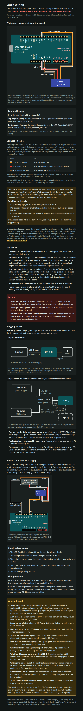

# Latch wiring

How the latch servo (DFRobot SER0006) connects to the Arduino UNO Q, with the parts the team has: no separate 5 V supply, so the servo takes its power from the board. One servo turns one axis, and both pull wires of the latch are fixed to that axis.

The same plan as a page that reads well on a phone: <https://claude.ai/artifact/R2eV8ii6dEn2Q5ypfEf7N7>. The source of that page is [`latch-wiring.html`](latch-wiring.html).

**Unplug the USB-C cable from the board before you wire anything.**

## Connections

Hold the board with the USB-C port on your left. The signal pins are on the top edge, the power pins on the bottom edge.

| # | From | To |
|---|---|---|
| 1 | Servo signal (orange) | UNO Q **D9**, top edge |
| 2 | Servo power (red) | UNO Q **5V**, bottom edge, fifth pin from the USB-C end |
| 3 | Servo ground (brown) | UNO Q **GND**, the pin right after 5V |

- **Finding D9:** the long header on the top edge has a small gap. From the gap, walking left toward USB-C: D8, then D9.
- **Finding 5V and GND:** the shorter header on the bottom edge starts at the USB-C end with BOOT, IOREF, RESET, 3V3, then 5V, GND, GND, VIN.
- **No breadboard is needed.** One servo means one red wire on 5V and one brown wire on GND. Each header pin holds one jumper, and nothing has to be joined.
- **Wire colours:** red = power, brown = ground, orange = signal. If the wires are gray, red and yellow: gray = ground, red = power, yellow = signal. On a standard servo plug the middle wire is power.
- **Jumpers:** the servo plugs and the board's headers are both sockets, so use jumper wires with pins on both ends.

## Mechanics

- **The servo is a 180 degree position servo.** It does not spin round and round. It turns at most half a turn.
- **How far it pulls.** Put a spool or horn of radius r on the axis. Half a turn pulls about 3.1 × r of wire (π × r). The sketch's default travel, 10° to 100°, is a quarter turn and pulls about 1.6 × r. Example: r = 1 cm gives about 1.6 cm of wire at the default angles, and up to about 3 cm if you widen the angles to 0 and 180.
- **How hard it pulls.** Rated torque is about 1.6 kg·cm at 4.8 V (DigiKey lists 156.9 mNm for the SER0006). Divide by r to get the pull: r = 1 cm gives about 1.6 kg at stall. Plan for well under half of that for both wires together: about 0.5 kg at r = 1 cm, about 0.25 kg at r = 2 cm. A servo that is held stalled gets hot and pulls enough current to reset the board.
- **Both wires go on the same axis,** wound the same way, so they rise together.
- **The open and closed angles** are the two constants at the top of the sketch (`SERVO_OPEN` and `SERVO_CLOSED`). Adjust them to the real latch.

## Do not

- **Never put 5 V on D3 or A0–A5.** Those pins take about 3.3 V only; 5 V there can destroy the microcontroller.
- **Never put a red (power) wire on a signal pin** such as D9.
- **Never swap a servo's red and brown wires**, and never wire with anything plugged in.

## The risk of powering the servo from the board

A servo pulls a burst of current when it starts to move. Here that burst comes from the board's own 5 V, and a big enough one can reset the UNO Q, which is also running the demo. What keeps it small: a light flap (cardboard) and nothing that can jam. A separate 5 V supply for the servo removes the risk; that wiring is on the page under "Better, if you find a 5 V supply".

## Plugging in USB

- **Now:** one USB-C cable from the laptop to the UNO Q. It powers the board and is how the demo is started and shown. No hub, no camera.
- **Only if we later use the live camera, or the servo resets the board:** the hub's cable into the UNO Q, the camera into a USB-A port on the hub, and the Arduino's power supply into the hub's power-in port (often marked "PD"). This works only if the hub has a power-in port, and the demo then has to be reached over Wi-Fi, which is not set up yet.
- The program plays recorded feeder video today. It does not read the live camera, so the camera is not needed for the latch.
- **The "Atech" board stays unconnected** until it is identified. Nothing by the name "Atech Frame 2.2" could be found; the marking on its largest chip and the text beside its connectors would identify it.

## First power-on

Until the sketch (`board/latch/latch.ino`) is uploaded the servo does nothing, which is normal. When it starts, the servo moves to the open position. The sketch reopens the latch by itself 30 seconds after the last close command.

## Not confirmed

- Servo wire colours come from a third-party page for the same servo family; DFRobot's own page could not be opened.
- Whether the SER0006 accepts a 3.3 V control signal (hobby servos normally do).
- How much current the UNO Q's 5V pin can give, and how much the laptop's USB-C port gives. No stall-current figure for the servo was found.
- Whether this hub has a power-in port, and whether this camera works on the board.
- The link from the program to the microcontroller has not been run on this board yet.

## The whole page as a picture

